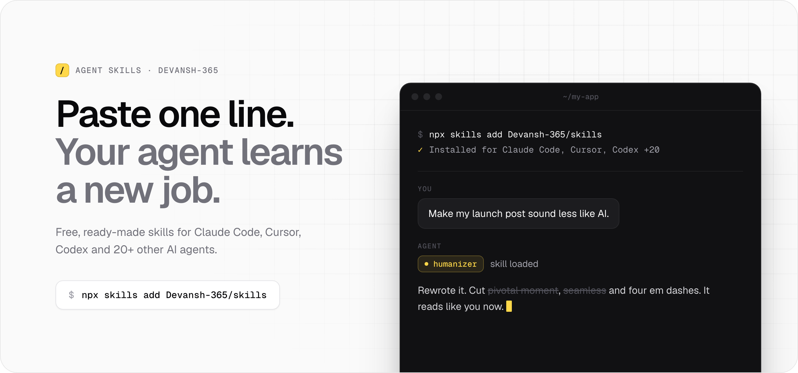

<picture>
  <source media="(prefers-color-scheme: dark)" srcset=".github/readme/hero-dark.png">
  
</picture>

A **skill** is a short playbook your AI agent reads before it starts a task. Without one, the agent guesses how
to do the job. With one, it follows the steps someone already tested.

You don't need to write code to use these. Install once, then ask for things in plain words.

## Start in 30 seconds

**Easiest: ask your agent to do it.** Open your project in Claude Code, Cursor or Codex and send this message:

```text
Install these skills by running: npx skills add Devansh-365/skills --skill '*' -y
```

**Or use the terminal yourself.** Run this in your project folder and pick the skills you want from the list:

```sh
npx skills add Devansh-365/skills
```

That's it. Next time you ask for something a skill covers, your agent uses it on its own.

> [!TIP]
> If you see `command not found: npx`, install Node.js from [nodejs.org](https://nodejs.org) first. It comes
> with `npx`.

## Skills

| Skill | What it does | Try saying |
|---|---|---|
| [humanizer](skills/humanizer/SKILL.md) | Rewrites text so it stops sounding like AI wrote it | "Make this post sound less like AI" |
| [peerlist-launch](skills/peerlist-launch/SKILL.md) | Prepares a full Peerlist launch: copy, logo, cover images, demo video and launch-day plan | "Launch this on Peerlist" |

Want just one? Add its name to the command:

```sh
npx skills add Devansh-365/skills --skill humanizer -y
```

## Questions

<details>
<summary><strong>Which AI tools does this work with?</strong></summary>
<br>

Claude Code, Cursor, Codex, Cline, Antigravity and 20+ others. The installer sets up the ones it finds in your
project.

</details>

<details>
<summary><strong>Is it free?</strong></summary>
<br>

Yes. The skills are free. Your agent uses its normal plan to run them.

</details>

<details>
<summary><strong>Is it safe?</strong></summary>
<br>

A skill is a text file of instructions, and your agent follows it with the same permissions it already has.
Read any skill before you install it. Each one is a single <code>SKILL.md</code> file, linked in the table above.

</details>

<details>
<summary><strong>Can I use the skills in all my projects?</strong></summary>
<br>

Yes. Add <code>-g</code> to install once for every project:

```sh
npx skills add Devansh-365/skills --skill '*' -g -y
```

</details>

<details>
<summary><strong>How do I remove a skill?</strong></summary>
<br>

Use its name from the table:

```sh
npx skills remove humanizer
```

</details>

<details>
<summary><strong>For contributors: how the repo works</strong></summary>
<br>

Each skill is a folder under `skills/` with a `SKILL.md` file. Its YAML frontmatter needs a `name` and a
`description`. The other folders are optional:

```text
skills/
  your-skill/
    SKILL.md        # required
    references/     # extra docs the agent reads when needed
    scripts/        # helper scripts
    assets/         # templates and static files
```

Add a row for it to the table above. Then try it from your local checkout and validate every skill before you
open a pull request:

```sh
npx skills add . --list
python -m pip install pyyaml==6.0.3
python scripts/validate_skills.py
```

The same check runs in GitHub Actions on every pull request and push to `main`.

</details>

<br>

---

**Found a skill useful?** A star helps other people find it. Have an idea for a skill or hit a bug?
[Open an issue](https://github.com/Devansh-365/skills/issues).
